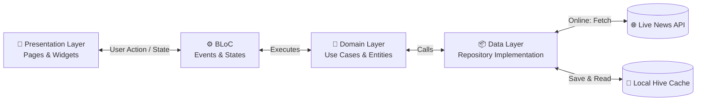
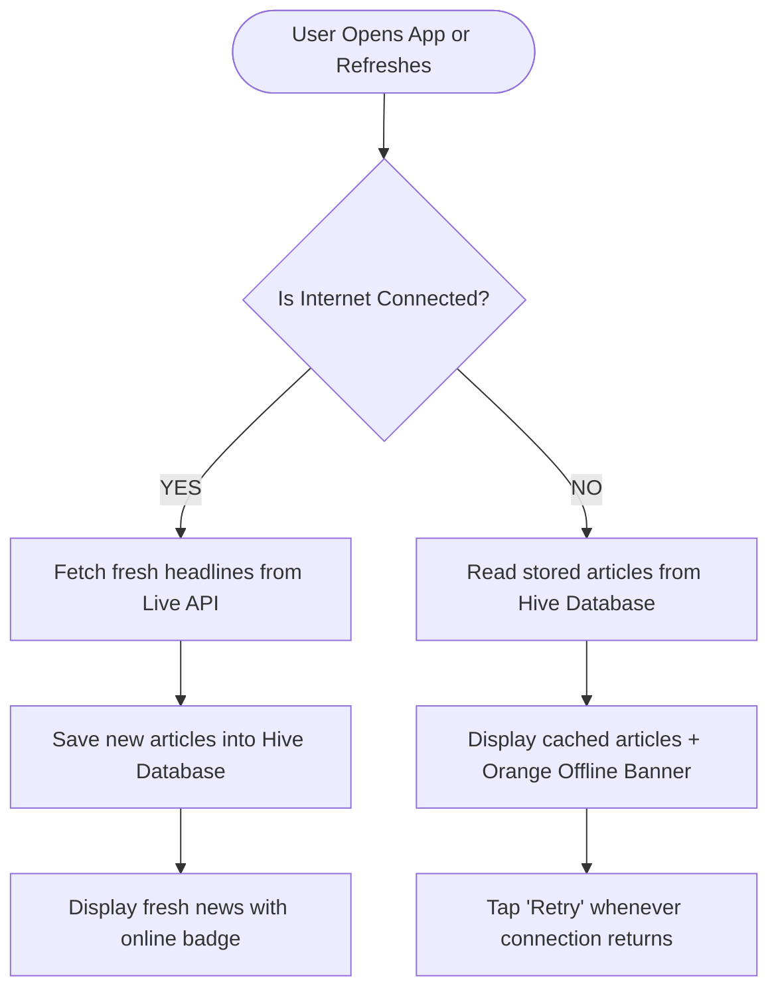

<div align="center">

  

  # ⚡ PulseNews

  **A modern, offline-first news app built with Flutter & Clean Architecture.**  
  *Read live headlines, search topics, and browse saved articles even without an internet connection.*

  <br/>

  [](https://flutter.dev)
  [](https://dart.dev)
  [](https://bloclibrary.dev)
  [](https://blog.cleancoder.com)
  [](https://docs.hivedb.dev)
  [](test/)
  [](analysis_options.yaml)

</div>

---

## 📖 Table of Contents
- [About the App](#-about-the-app)
- [Key Features](#-key-features)
- [How It Works (Visual Flow)](#-how-it-works)
- [Project Architecture](#-project-architecture)
- [Responsive on Every Screen](#-responsive-on-every-screen)
- [Quick Start Guide](#-quick-start-guide)
- [Automated Tests](#-automated-tests)
- [Tech Stack](#-tech-stack)

---

## 📱 About the App

**PulseNews** is designed to give users a fast, smooth, and dependable news experience. It pulls real-time news articles from a live remote API without needing any API keys or complicated registration. 

When your internet is fast, it fetches the latest stories and saves a copy locally. If your Wi-Fi or mobile data disconnects, the app switches to **Offline Mode** automatically so you can keep reading your news seamlessly.

---

## ✨ Key Features

| Feature | Description | Benefit |
| :--- | :--- | :--- |
| **🌐 Real Live News** | Fetches live articles directly from the public news API. | No API keys needed; works out of the box. |
| **💾 Offline First** | Saves articles to a fast local Hive database. | Read news anytime, even without Wi-Fi. |
| **🔍 Instant Search** | Filter stories by keyword in real time. | Quickly find topics and breaking headlines. |
| **🌓 Dark & Light Mode** | One-tap switch between sleek dark and clean light themes. | Easy on the eyes day or night; remembers your choice. |
| **🔄 Pull-to-Refresh & Pagination** | Drag down to refresh or scroll down to load more stories. | Smooth, infinite feed browsing. |
| **📱 100% Mobile Responsive** | Tailored for small phones, tablets, foldables, and landscape. | Never cuts off text or overflows on any device. |

---

## 🔄 How It Works

### 1. Data Flow (Clean Architecture)


### 2. Offline-First Decision Logic


---

## 🏗️ Project Architecture

The app is built following Uncle Bob's **Clean Architecture**, keeping business rules independent from UI and third-party packages:

```text
lib/
├── core/                         # Shared tools, constants & utilities
│   ├── constants/                # Colors, API endpoints
│   ├── network/                  # Internet connectivity listener
│   ├── theme/                    # Light & dark theme palettes
│   └── service_locator.dart      # Dependency injection (GetIt)
│
├── features/
│   ├── splash/                   # Animated splash screen & branding
│   └── news/
│       ├── domain/               # 🎯 Core business logic (Pure Dart)
│       │   ├── entities/         # Article blueprint
│       │   ├── repositories/     # News repository contract
│       │   └── usecases/         # Fetch, Search & Cache use cases
│       │
│       ├── data/                 # 📦 Data sources & models
│       │   ├── datasources/      # Remote (Dio API) & Local (Hive DB)
│       │   ├── models/           # ArticleModel JSON parsing
│       │   └── repositories/     # Offline/Online coordination logic
│       │
│       └── presentation/         # 📱 UI & State Management
│           ├── bloc/             # NewsBloc (States & Events)
│           ├── pages/            # NewsListPage & ArticleDetailPage
│           └── widgets/          # ArticleCard, SearchBar, OfflineBanner
│
└── main.dart                     # App entry point
```

---

## 📲 Responsive on Every Screen

PulseNews is carefully tested to look beautiful and avoid layout errors (`RenderFlex overflow`) across all device types:

* **Compact Mobiles (300dp–360dp)**: Dynamic text truncation for publisher names and date tags.
* **Standard Mobiles (375dp–430dp)**: Perfectly balanced card aspect ratios and spacing.
* **Large Mobiles & Tablets (600dp+)**: Centered content with a max-width limit (`720dp`) to avoid stretched cards.
* **Landscape Orientation**: Adaptive header height on article details and scroll-safe empty/splash states.
* **Accessibility / Large Fonts**: Flexible text boxes prevent clipping when users enable large system fonts.

---

## 🚀 Quick Start Guide

Run this app on your computer in 3 simple steps:

### 1. Clone the repository
```bash
git clone https://github.com/YogeshBendkoli25/PulseNews_App.git
cd PulseNews_App
```

### 2. Download packages
```bash
flutter pub get
```

### 3. Run the app
```bash
flutter run
```
*(No environment variables, API keys, or setup configs needed. It just works!)*

---

## 🧪 Automated Tests

The codebase includes full test coverage for models, state transitions, and responsive widgets:

```bash
# Check code quality (guaranteed 0 issues)
flutter analyze

# Run all 20 automated tests
flutter test
```

### What the tests cover:
- **Model Tests**: JSON parsing, null handling, and data integrity.
- **BLoC Tests**: State flow verification (`Loading` ➔ `Loaded` / `Offline` / `Error`).
- **Widget Tests**: Tap handlers, branding watermark, and overflow prevention on small screens.

---

## 🛠️ Tech Stack

| Technology | Purpose | Why It Was Chosen |
| :--- | :--- | :--- |
| **Flutter 3.x** | Cross-platform framework | High performance 60fps native UI on iOS and Android. |
| **flutter_bloc** | State management | Predictable, testable, event-driven architecture. |
| **Hive** | Local database | Ultra-fast key-value storage with zero native setup. |
| **Dio** | HTTP network client | Reliable REST API client with timeouts and error parsing. |
| **get_it** | Dependency injection | Decouples classes for clean code and easy unit testing. |
| **cached_network_image** | Image caching | Fast image loading with shimmer placeholders and memory cache. |

---

<div align="center">
  <sub>Built with ❤️ using Flutter and Clean Architecture.</sub>
</div>
